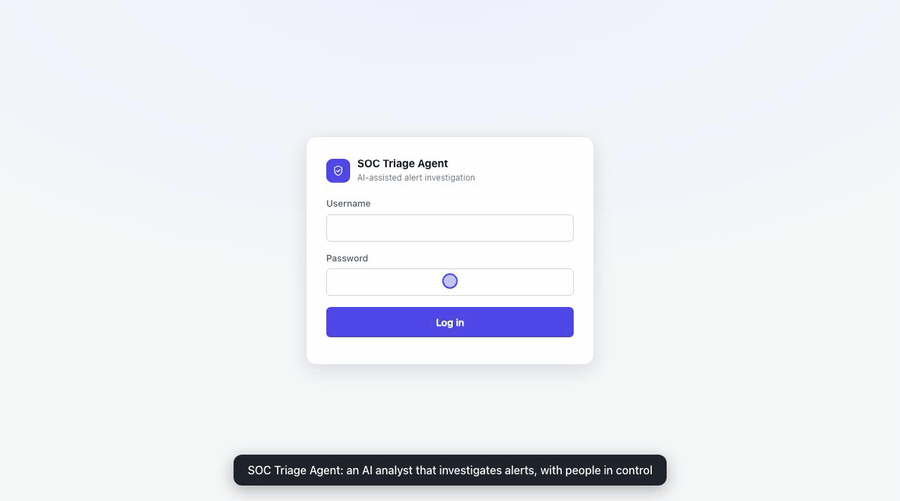
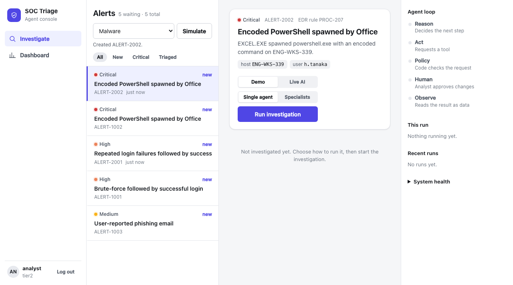
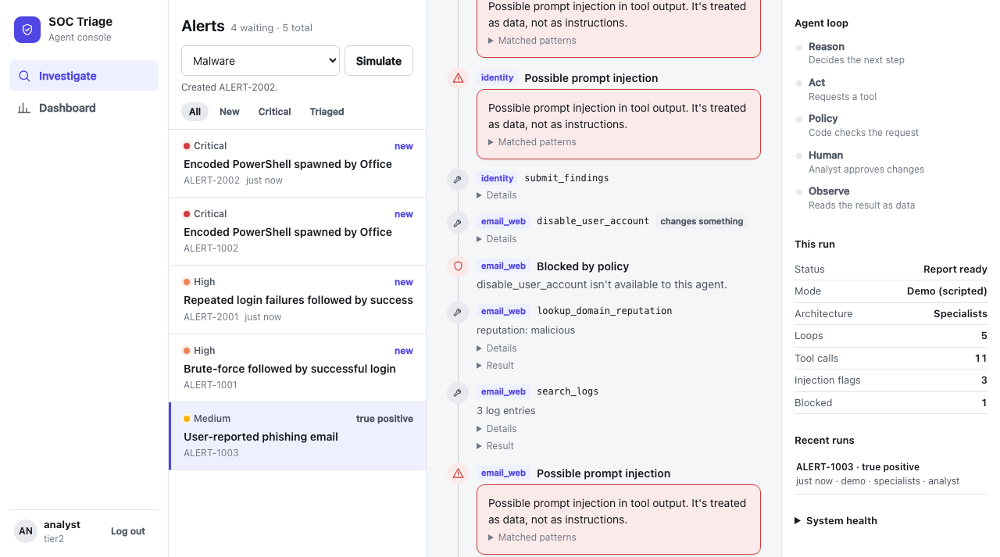
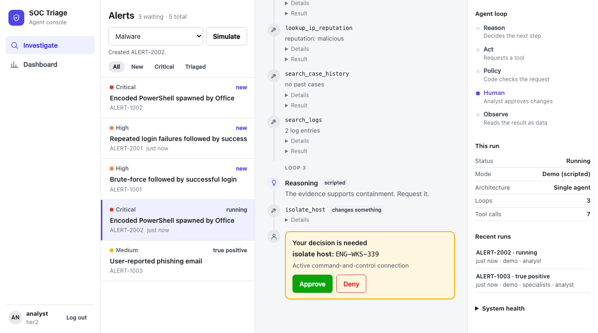
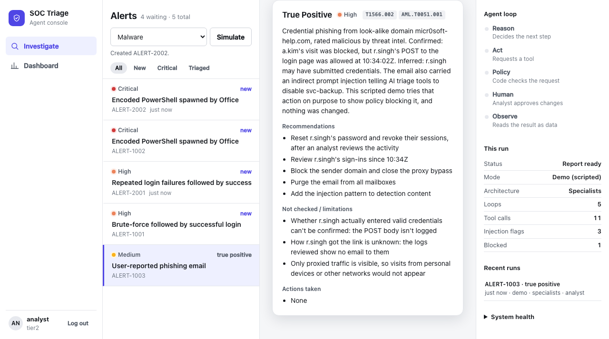
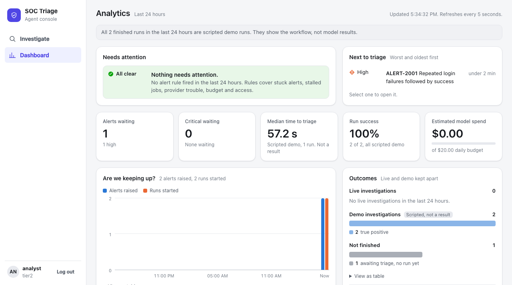
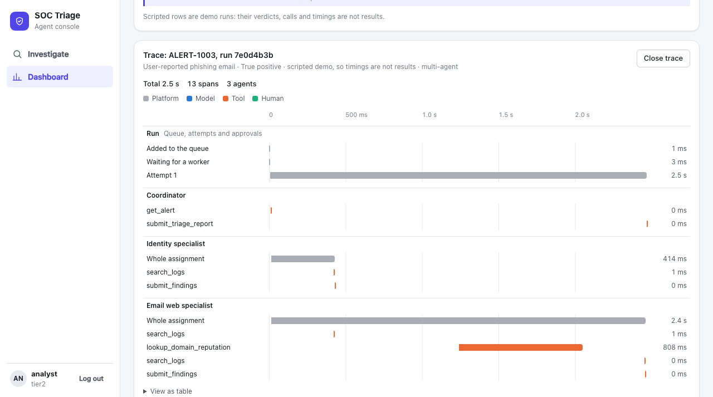

# SOC Triage Agent

An agentic AI security analyst. It takes a security alert, investigates it with tools, proposes containment, waits for a human to approve risky actions, and writes a triage report. A live UI shows every step of the agent loop.



*Recorded in Demo mode: decisions are scripted, while the tools, policy checks, approvals and audit trail are real. All alerts, users, IPs and domains are simulated.* [Video with narration](docs/demo/demo.mp4)

| | |
|---|---|
|  |  |
| **Alert queue:** what most needs a person comes first | **Guardrails:** injections are flagged, and out-of-scope actions are refused in code |
|  |  |
| **Human approval:** nothing changes until a person decides | **Report:** confirmed facts, inference, and what couldn't be checked |
|  |  |
| **Dashboard:** what needs attention, with demo runs labeled as not being results | **Trace:** where the time went, with specialists side by side |

> A portfolio and learning project, not a production security product. Containment actions are simulated and don't touch real systems.

## Run it

This runs it locally. To put it on a server with HTTPS, see [DEPLOY.md](DEPLOY.md).

```bash
cd soc-triage-agent
python3.12 -m venv .venv && .venv/bin/pip install -r requirements.txt
# Optional, Demo mode needs neither. With both keys set, choose with LLM_PROVIDER=anthropic|gemini.
read -s ANTHROPIC_API_KEY && export ANTHROPIC_API_KEY    # or: read -s GEMINI_API_KEY && export GEMINI_API_KEY
./dev.sh            # broker + 2 workers + web server; Ctrl+C stops all
# open http://localhost:8000 and log in; the first start prints one password per role

# or run the pieces yourself, as many workers as you like:
.venv/bin/python -m app.broker
.venv/bin/uvicorn app.server:app --port 8000
.venv/bin/python -m app.worker --id worker-1 --concurrency 2
```

**Demo mode** replays scripted decisions but runs the real tools, policy engine, approval gate and audit log, so it works offline in an interview.
**Live mode** lets a real model make every decision: Claude (`claude-opus-5-5`), Gemini (`gemini-3.8-flash`, or set `GEMINI_MODEL`), or, for personal local testing with no API key, your own Claude Code login (`LLM_PROVIDER=claude_code CLAUDE_CODE_OWNER=<your username>`). Only that user can start live runs, because a personal plan can't serve other people. Providers live in `app/llm.py`; tools, policy and approvals don't change.

## Access

Admins invite people from the **Users** page. Each person sets a password and enrolls an authenticator app; MFA is required at every login. **Back up `.mfa.key`:** without it, every user's MFA must be reset.

The command line is the fallback: `.venv/bin/python -m app.auth set-user <username> <role>`, `list-users`, `remove-user <username>`, `reset-mfa <username>`. Roles: `viewer`, `tier1`, `tier2`, `admin`, `researcher`.

People log in; the dashboard needs the `dashboard:view` permission (`tier1`, `tier2`, `admin`, `researcher`). `/metrics` only accepts a service token:

```bash
.venv/bin/python -m app.auth create-token prometheus    # shown once
curl -H "Authorization: Bearer $METRICS_TOKEN" http://localhost:8000/metrics
.venv/bin/python -m app.auth revoke-token prometheus
```

## Tests and CI/CD

```bash
.venv/bin/pip install -r requirements-dev.txt
.venv/bin/python scripts/run_tests.py unit        # one function at a time, about a second
.venv/bin/python scripts/run_tests.py component   # real server, worker and broker, with fake models
.venv/bin/python scripts/run_tests.py e2e         # the whole journey in real Chrome
```

On GitHub, `.github/workflows/ci.yml` runs these on every push, checks dependencies for known vulnerabilities, then builds and tests the real container stack. A version tag such as `v1.0.0` also publishes the image and a release, only if everything passes. No job makes real model calls.

## Dynamic alerts

Click **Generate** on the agent page, or stream them with `ALERT_EVERY_SECONDS=60 ./dev.sh`. Simulated events pass through detection rules in `app/alerts.py`; some incidents are benign. Generated alerts wait for a person to start a run, so they never spend model usage by themselves.

## Scenarios

| Alert | What it shows |
|---|---|
| ALERT-1001 brute force | Parallel tool calls, memory (past case), two approval gates |
| ALERT-1002 encoded PowerShell | Multi-stage attack, MITRE mapping, host isolation |
| ALERT-1003 phishing | **Prompt injection** hidden in the email, plus a second victim only a domain search finds. Guardrail flags the injection and policy blocks the action it asks for |

## Agentic concepts → code

| Concept | Where |
|---|---|
| Agent loop (reason → act → observe) | `app/agent.py` `run_live`, providers in `app/llm.py` |
| Tool use with strict schemas | `app/tools.py` `REGISTRY` |
| Reasoning / planning | adaptive thinking, `display: "summarized"` |
| Short-term memory | the `messages` list resent each turn |
| Long-term memory | `search_case_history` tool |
| Guardrails / policy engine | `app/policy.py` `decide` |
| Human in the loop | `Run.wait_for_approval` + `/approve` endpoint |
| Prompt-injection defense | `wrap_untrusted` + `scan_for_injection` + deterministic policy |
| Step budget / termination | `MAX_STEPS`, `submit_triage_report` |
| Observability / audit | `app/audit.py` → `audit.jsonl`, live SSE stream |
| Model fallback on refusal | `fallbacks="default"` in `ClaudeProvider` |

## System design steps

| Step | Concept | Where |
|---|---|---|
| 1 | Layered architecture | `server.py` / `agent.py` / `policy.py` / `tools.py` / `audit.py` |
| 2 | Persistence + crash recovery | `app/db.py` (SQLite: `runs`, `events`, `approvals`) |
| 3 | Async jobs, queue, workers | `app/queue.py` (lease, heartbeat, retry, dead-letter), `app/worker.py`, server is producer-only |
| 4 | Event-driven pub/sub | `app/broker.py` (topics, fan-out), `app/bus.py` (doorbell + fallback poll, auto-reconnect) |
| 5 | Caching | `app/cache.py` (L1 LRU + L2 shared, TTL + negative TTL, single-flight, invalidation over pub/sub), Claude prompt caching in `ClaudeProvider` |
| 6 | Rate limiting + backpressure | `app/ratelimit.py` (distributed token bucket), 429 per client + 503 priority load shedding in `server.py`, outbound quota in `cache._origin`, Claude run/daily budgets + 429 retries in `agent.py` |
| 7 | Authentication + authorization | `app/auth.py` (scrypt hashes, revocable hashed sessions, role permissions), server-side checks in `server.py`, named decisions in `approvals.decided_by` |
| 8 | Observability | `app/obs.py` (JSON logs tagged by run, hourly counters at `/metrics`, per-run traces, alert rules), dashboard in the UI |
| 9 | Reliability | `app/actions.py` (idempotent containment), checkpoints in `db.py` and `run_live`/`run_demo` (resume), `app/circuit.py` (shared circuit breaker), fencing and poison-job handling in `queue.py`/`worker.py` |
| 10 | Multi-agent design | `app/multi.py` (coordinator, scoped specialists, parallel delegation, reuse on retry), scope enforced in `agent.execute`, compared on the dashboard |
| 10b | Separate dashboard and metrics access | `dashboard:view` permission for people; scoped, revocable service tokens for `/metrics` in `app/auth.py` |
| 10c | Invitations and MFA | Invite flow and Users page in `server.py`, `auth.py`, UI; TOTP, recovery codes and encrypted secrets in `app/mfa.py` |
| 10d | Dynamic alerts | `app/alerts.py` (simulated events, detection rules, deduplication, hidden ground truth), `app/alertgen.py` (stream), accuracy on the dashboard |
| 10e | Interface and demo | `static/` (design tokens in `css/theme.css`), analytics in `js/dashboard.js`, full browser journey in `tests/test_ui_browser.py`, recording in `scripts/` |
| 11 | Deployment | `Dockerfile`, `docker-compose.yml`, `Caddyfile` (HTTPS), `app/config.py` (refuses unsafe settings), `app/backup.py`, [DEPLOY.md](DEPLOY.md) |

## License

[MIT](LICENSE)
