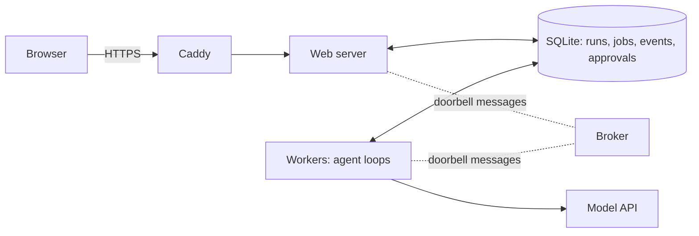

# System design

How the project is built, and where to find each idea in the code. For how the agents themselves work, start with the [README](../README.md#how-an-agent-thinks).

## Agentic concepts in the code

| Concept | Where |
|---|---|
| Agent loop (reason → act → observe) | `app/agent.py` `run_live`, providers in `app/llm.py` |
| Tool use with strict schemas | `app/tools.py` `REGISTRY` |
| Reasoning / planning | adaptive thinking, `display: "summarized"` |
| Short-term memory | the `messages` list resent each turn |
| Long-term memory | `search_case_history` tool |
| Guardrails / policy engine | `app/policy.py` `decide` |
| Human in the loop | `Run.wait_for_approval` + `/approve` endpoint |
| Prompt-injection defense | `wrap_untrusted` + `scan_for_injection` + deterministic policy |
| Step budget / termination | `MAX_STEPS`, `submit_triage_report` |
| Observability / audit | `app/audit.py` → `audit.jsonl`, live SSE stream |
| Model fallback on refusal | `fallbacks="default"` in `ClaudeProvider` |

## System design, step by step

| Step | Concept | Where |
|---|---|---|
| 1 | Layered architecture | `server.py` / `agent.py` / `policy.py` / `tools.py` / `audit.py` |
| 2 | Persistence + crash recovery | `app/db.py` (SQLite: `runs`, `events`, `approvals`) |
| 3 | Async jobs, queue, workers | `app/queue.py` (lease, heartbeat, retry, dead-letter), `app/worker.py`, server is producer-only |
| 4 | Event-driven pub/sub | `app/broker.py` (topics, fan-out), `app/bus.py` (doorbell + fallback poll, auto-reconnect) |
| 5 | Caching | `app/cache.py` (L1 LRU + L2 shared, TTL + negative TTL, single-flight, invalidation over pub/sub), Claude prompt caching in `ClaudeProvider` |
| 6 | Rate limiting + backpressure | `app/ratelimit.py` (distributed token bucket), 429 per client + 503 priority load shedding in `server.py`, outbound quota in `cache._origin`, Claude run/daily budgets + 429 retries in `agent.py` |
| 7 | Authentication + authorization | `app/auth.py` (scrypt hashes, revocable hashed sessions, role permissions), server-side checks in `server.py`, named decisions in `approvals.decided_by` |
| 8 | Observability | `app/obs.py` (JSON logs tagged by run, hourly counters at `/metrics`, per-run traces, alert rules), dashboard in the UI |
| 9 | Reliability | `app/actions.py` (idempotent containment), checkpoints in `db.py` and `run_live`/`run_demo` (resume), `app/circuit.py` (shared circuit breaker), fencing and poison-job handling in `queue.py`/`worker.py` |
| 10 | Multi-agent design | `app/multi.py` (coordinator, scoped specialists, parallel delegation, reuse on retry), scope enforced in `agent.execute`, compared on the dashboard |
| 10b | Separate dashboard and metrics access | `dashboard:view` permission for people; scoped, revocable service tokens for `/metrics` in `app/auth.py` |
| 10c | Invitations and MFA | Invite flow and Users page in `server.py`, `auth.py`, UI; TOTP, recovery codes and encrypted secrets in `app/mfa.py` |
| 10d | Dynamic alerts | `app/alerts.py` (simulated events, detection rules, deduplication, hidden ground truth), `app/alertgen.py` (stream), accuracy on the dashboard |
| 10e | Interface and demo | `static/` (design tokens in `css/theme.css`), analytics in `js/dashboard.js`, full browser journey in `tests/test_ui_browser.py`, recording in `scripts/` |
| 11 | Deployment | `Dockerfile`, `docker-compose.yml`, `Caddyfile` (HTTPS), `app/config.py` (refuses unsafe settings), `app/backup.py`, [DEPLOY.md](../DEPLOY.md) |

## How the processes fit together

- **The web server never runs agents.** It records the run, queues a job and returns, so it stays responsive.
- **The database is the source of truth.** Broker messages only say "something changed, go look", so losing one costs a few seconds, not data.
- **Workers can die safely.** Jobs are leased, finished actions aren't repeated, and retries resume from the last completed loop.
